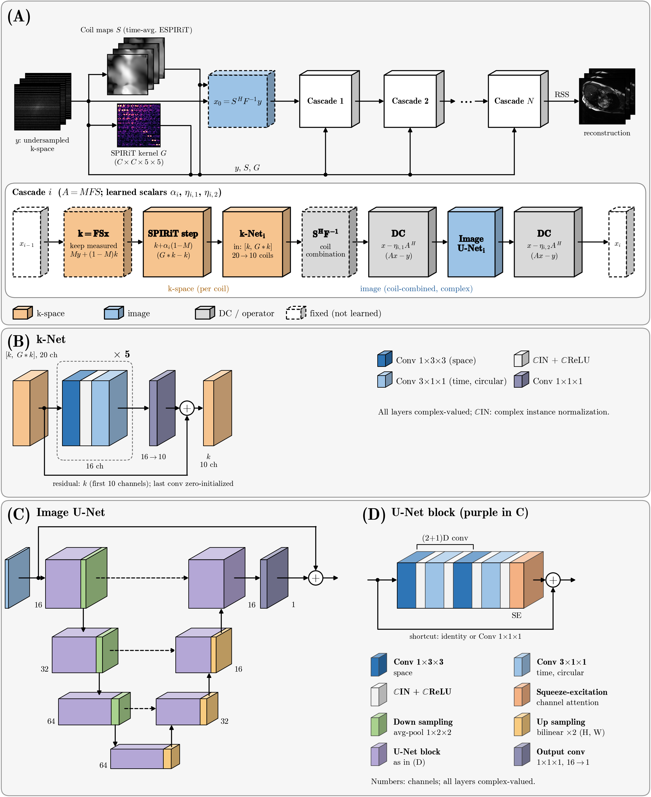

# stC³-Net

Code for **"stC³-Net: A Spatiotemporal Complex-Valued Cascaded Cross-Domain
Network with Learned k-Space Refinement for Highly Accelerated Cine Cardiac
MRI"** (Yan K, Dou Q, Wang Z, Diao J, Feng X, Meyer CH, Mugler JP III;
submitted to the *Journal of Cardiovascular Magnetic Resonance*).

stC³-Net is an unrolled reconstruction network for undersampled multi-coil
cine MRI (5,962,616 trainable parameters).



*(A) Overview: coil maps and a per-scan SPIRiT kernel are estimated from the
time-averaged undersampled k-space, eight cascades are applied, and the
output is the root-sum-of-squares of the data-consistent multi-coil k-space.
Each cascade applies a SPIRiT update, a complex-valued (2+1)D k-space network,
data consistency, a complex-valued (2+1)D image U-Net and a second data
consistency step. (B) k-space network. (C) Image U-Net. (D) U-Net block.*

## Contents

| Path | Content |
|---|---|
| `src/networks/stc3.py` | stC³-Net (`STC3Net`) |
| `src/networks/unet.py`, `ctorch.py`, `dc.py`, `models.py`, `losses.py` | complex-valued (2+1)D layers and U-Nets, data consistency, SSIM loss |
| `src/utils/vista.py` | VISTA sampling (NumPy port of the OSU MATLAB code; see licence note) |
| `src/utils/ttv.py`, `recon.py` | ESPIRiT coil maps, CG-SENSE and ℓ1-ESPIRiT with temporal TV (non-learned references in the evaluation) |
| `src/build_dataset.py`, `build_ocmr.py`, `build_vista_maps.py` | data preparation and coil maps |
| `src/train.py` | training |
| `src/eval_vista.py` | test-set evaluation (SSIM, PSNR, NMSE per frame) |
| `configs/` | the training arguments of stC³-Net and of its ablation variants |
| `masks/vista/` | cached VISTA patterns (regenerated automatically if missing) |
| `docs/` | architecture figure |
| `scripts/` | data download, model loading (`preview_recon.py`) and LV-volume analysis with nnU-Net |

## Installation

Tested with Python 3.9 and 3.10 and a CUDA GPU (the paper used one NVIDIA
RTX A6000, 48 GB).

```bash
git clone https://github.com/kangyans/stC3-Net.git
cd stC3-Net
pip install -r requirements.txt
```

## Data

* **CMRxRecon 2023** (training and internal validation): multi-coil cine
  training set, available from the challenge organizers under their
  data-use terms (Synapse). `scripts/download_cmrxrecon.py` downloads it
  with a personal Synapse access token (`SYNAPSE_AUTH_TOKEN`).
* **OCMR** (external test set): openly available at <https://www.ocmr.info>;
  `scripts/download_ocmr.py` downloads the fully sampled files
  (asymmetric-echo and aliased-field-of-view scans are skipped by default).

No data are included in this repository.

## Usage

All commands are run from `src/`. Paths in capitals are your own.

**1. Prepare the data.** CMRxRecon: the first 110 subjects (sorted) form the
training set, the remaining subjects the validation set.

```bash
python build_dataset.py --old_root CMRX/MultiCoil/Cine/TrainingSet/FullSample \
    --new_root BUILT/challenge/MultiCoil/Cine/train --subject_range 0 110
python build_dataset.py --old_root CMRX/MultiCoil/Cine/TrainingSet/FullSample \
    --new_root BUILT/challenge/MultiCoil/Cine/val --subject_range 110 120
python build_ocmr.py --raw_dir OCMR/raw --out_dir BUILT/ocmr/MultiCoil/Cine/test \
    --attributes OCMR/ocmr_data_attributes.csv
```

**2. Precompute the coil maps** (ESPIRiT from the time-averaged
VISTA-undersampled data; optional, otherwise computed on the fly).

```bash
python build_vista_maps.py --data_dir BUILT/challenge/MultiCoil/Cine/train \
    --R 4 6 8 10 12 16 --pattern vista_dc
python build_vista_maps.py --data_dir BUILT/challenge/MultiCoil/Cine/val \
    --R 4 6 8 10 12 16 --flips 0 --pattern vista_dc
python build_vista_maps.py --data_dir BUILT/ocmr/MultiCoil/Cine/test \
    --R 8 10 12 16 --flips 0 --no_align --pattern vista_dc
```

**3. Train.** `configs/train_stc3.txt` holds the arguments of stC³-Net,
`configs/train_ablation.txt` those of the ablation variants (one run per
line):

```bash
python train.py --trn_dir BUILT/challenge/MultiCoil/Cine/train \
    --val_dir BUILT/challenge/MultiCoil/Cine/val --out_dir EXP --use_gpu \
    --exp_name vista_dc_e40_stC3 --stc3 --mask vista_dc \
    --train_R 4 6 8 10 12 16 --val_R 4 6 8 10 12 16 --grad_checkpoint \
    --learning_rate 1e-3 --scheduler cosine --num_epochs 40
```

The weights of the final epoch (`EXP/<exp_name>/ckpt.pt`) are used for
evaluation; `args.json` in the same folder stores the full configuration.

**4. Evaluate.** One CSV row per slice, frame, R and method; zero-filled,
CG-SENSE and CS-tTV reconstructions are computed alongside (`--baselines`
selects them).

```bash
python eval_vista.py --data_dir BUILT/challenge/MultiCoil/Cine/val \
    --subjects 'P11[2-9]' --dataset cmrx --R 8 10 12 16 \
    --runs stC3=EXP/vista_dc_e40_stC3 --use_gpu --out RESULTS/cmrx_test.csv
python eval_vista.py --data_dir BUILT/ocmr/MultiCoil/Cine/test --subjects '_3T_' \
    --dataset ocmr --no_align --R 8 10 12 16 \
    --runs stC3=EXP/vista_dc_e40_stC3 --use_gpu --out RESULTS/ocmr.csv
python eval_vista.py --summarize RESULTS/ocmr.csv --reference stC3
```

Add `--save_recon DIR` to store the reconstructions.

## Trained weights

The final-epoch weights of stC³-Net and its ablation variants will be
released with the publication (link to be added).

## Licence

The authors' code is released under the MIT licence (`LICENSE`).
`src/utils/vista.py` is a port of the VISTA reference code of The Ohio
State University and keeps its original notice, which permits use for
educational, research and not-for-profit purposes only; see
`THIRD_PARTY_NOTICES.md`.

## Citation

If you use this code, please cite the paper (reference to be added on
publication) and, when you use the sampling code, the VISTA publication
(Ahmad R, et al. Magn Reson Med. 2015;74:1266–78).
